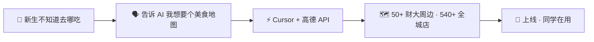
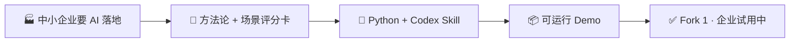
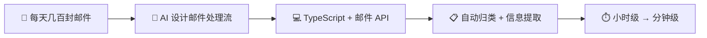

# 👋 Hi, I'm Robin / 房

> 非技术背景的 AI-native Builder · 大学生创业者
> Non-tech builder & AI-native creator. I vibe-code everything—not a single line hand-written.

📺 [B站](https://space.bilibili.com/1340728968) · 📕 [小红书](https://www.xiaohongshu.com/user/profile/685b590b000000001b021d86) · 🎵 [抖音](https://www.douyin.com/user/self?from_tab_name=main) · 🐦 [X](https://x.com/Robin126988)

---

## 🗺️ 武汉美食地图 — AI 做地图，谁说不行

大一发现财大周边好吃的太多，新生根本不知道去哪吃。跟 AI 聊了聊需求，调了个地图 API，一张覆盖 **财大周边 50+ 家 + 全城 540+ 家** 的武汉美食地图就上线了。

## 🧰 FDE Project Evolution — 给中小企业用的 AI 工具包

跑了一圈中小企业，发现他们需要的不是酷炫 AI，而是贴地气的工作流。FDE 工具包 = 方法论 + 评分卡 + Codex Skill，开发者拿去就能跑。

## 📧 货代邮件工作台 — AI 帮老业务省时间

货代行业每天几百封邮件，人工翻到崩溃。用 AI 搭了个工作台，自动归类、提取关键信息，从小时级到分钟级。

---

## 💬 来找我聊聊

也在用 AI 做产品 / 做内容？或者有个想法想找人一起搞？

📱 **微信：** weiyangfang950

> 以上所有项目我一行代码都没手写过——全是 AI 帮我写的。
> 如果你也好奇"非技术背景到底能不能做出有用的东西"，我就是个活例子。
